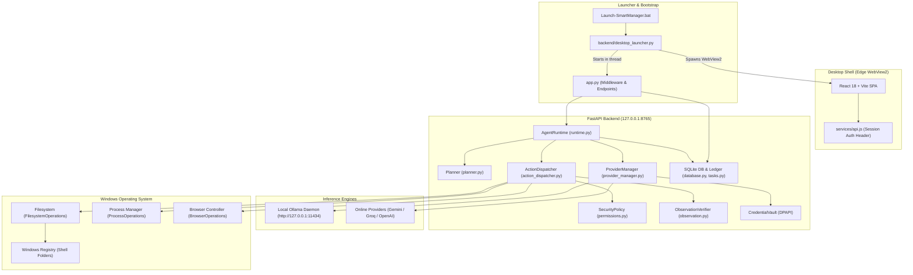
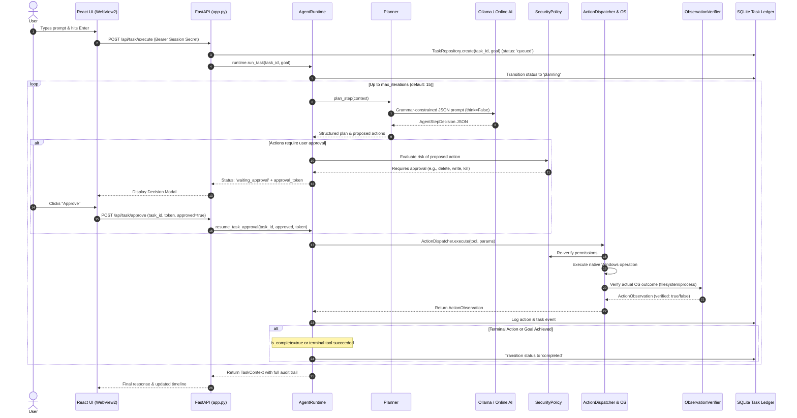

Listed directory Smart-Manager
Viewed README.md:1-106
Listed directory backend
Listed directory agent
Listed directory ai
Listed directory execution
Listed directory security
Listed directory storage
Listed directory frontend
Listed directory src
Listed directory src-tauri
Listed directory scripts
Viewed Launch-SmartManager.bat:1-37
Viewed desktop_launcher.py:1-100
Viewed app.py:1-150
Viewed app.py:151-350
Viewed app.py:351-550
Viewed app.py:551-696
Viewed config.py:1-69
Viewed runtime.py:1-160
Viewed runtime.py:161-337
Viewed model.py:1-160
Viewed model.py:161-246
Viewed planner.py:1-87
Viewed context.py:1-111
Viewed provider_manager.py:1-120
Viewed action_dispatcher.py:1-164
Viewed permissions.py:1-185
Viewed filesystem.py:1-100
Viewed filesystem.py:101-250
Viewed filesystem.py:251-430
Viewed processes.py:1-117
Viewed browser.py:1-48
Viewed shell.py:1-39
Viewed credentials.py:1-155
Viewed database.py:1-160
Viewed tasks.py:1-86
Viewed observation.py:1-105
Listed directory components
Listed directory services
Viewed api.js:1-255
Viewed App.jsx:1-120
Listed directory tests
Viewed CHANGELOG.md:1-79
Viewed launch_mode.py:1-30
Ran command: `.\.venv\Scripts\pytest.exe -v`
Viewed .env:1-28
Viewed test_hardware_resource.py:1-62

# Smart Manager: Complete Codebase Analysis & Architecture Documentation

**Smart Manager** is an autonomous, privacy-centric Windows desktop assistant. It translates plain-language user requests into structured, verified operating system operations using either local open-weight Large Language Models (via **Ollama**) or opt-in cloud AI providers (**Google Gemini**, **Groq**, **OpenAI**, or custom endpoints).

Unlike traditional AI assistants that blindly run shell scripts, Smart Manager operates under a **Zero-Trust Model** toward LLM outputs: generic shell execution is disabled, all state-changing actions are gated behind cryptographic approval tokens, and every OS operation is verified against actual filesystem and process states.

---

## 1. System Architecture Overview

Smart Manager consists of a desktop container running Microsoft Edge WebView2, a local FastAPI backend bound strictly to loopback, an autonomous agent runtime loop, controlled OS execution handlers, and a durable SQLite ledger.



---

## 2. End-to-End Workflow: The Observe-Plan-Act-Verify Loop

When a user submits a prompt (e.g., *"Find the literature review PDF on my Desktop and open it"*), the system executes through the following stages:



---

## 3. Deep Dive: Key Subsystems & Components

### 3.1. Desktop Launcher & Lifecycle Management
- **[`Launch-SmartManager.bat`](file:///d:/my%20projects/Smart-Manager/Launch-SmartManager.bat)**:
  - Validates `.venv\Scripts\python.exe`.
  - Runs [`backend/launch_mode.py`](file:///d:/my%20projects/Smart-Manager/backend/launch_mode.py) to inspect whether the user configured local or online inference.
  - If in local/auto mode, it queries `http://127.0.0.1:11434/api/tags`. If Ollama is not active, it starts `ollama.exe serve` in a hidden, non-interactive background process.
  - Launches [`backend/desktop_launcher.py`](file:///d:/my%20projects/Smart-Manager/backend/desktop_launcher.py).
- **[`backend/desktop_launcher.py`](file:///d:/my%20projects/Smart-Manager/backend/desktop_launcher.py)**:
  - Generates a cryptographically strong 32-byte URL-safe secret (`secrets.token_urlsafe(32)`).
  - Configures `API_SESSION_SECRET` in environment and [`Settings`](file:///d:/my%20projects/Smart-Manager/backend/config.py#L6-L68).
  - Starts the FastAPI backend inside a background daemon thread.
  - Polls `/api/health` with `X-Smart-Manager-Session` until ready (10s timeout).
  - Spawns a native desktop window via `pywebview` using **Microsoft Edge WebView2** pointing to the frontend URL with `?sm_session=<secret>`.
- **Note on the Observed Launch Output**:
  In the user's terminal:
  ```text
  The system cannot find the path specified.
  [Notice] Starting Ollama daemon in the background...
  Launching Smart Manager...
  ```
  This warning occurs at line 20 of [`Launch-SmartManager.bat`](file:///d:/my%20projects/Smart-Manager/Launch-SmartManager.bat#L20) (`for /f "usebackq delims=" %%M in (`".venv\Scripts\python.exe" "backend\launch_mode.py"`) do set "AI_MODE=%%M"`). In Windows CMD, backtick commands inside `for /f` strip outer quotes when multiple quoted parameters are passed, causing cmd.exe to fail to locate `.venv\Scripts\python.exe`. It gracefully fell back to `AI_MODE=local`, verified Ollama, and booted successfully.

---

### 3.2. Agent Runtime & Planning Engine
- **[`backend/agent/runtime.py`](file:///d:/my%20projects/Smart-Manager/backend/agent/runtime.py)**:
  - Manages active task contexts in memory.
  - Implements concurrency protection: prevents duplicate task IDs and bounds iterations to `settings.agent_max_iterations` (15 steps).
  - Handles asynchronous task cancellation (`cancel_task`), immediately retiring context and signaling Ollama to unload model weights to conserve RAM.
  - Intercepts approval requirements (`WAITING_APPROVAL`), issues single-use approval tokens, and pauses execution until explicit user consent is returned.
- **[`backend/agent/planner.py`](file:///d:/my%20projects/Smart-Manager/backend/agent/planner.py)**:
  - Provides system prompts establishing operational boundaries (no shell access, path preservation rules, fuzzy search tips).
  - Formats the last 3 execution steps (plan, actions, observations, errors) to keep prompt context bounded within token limits.
  - Uses **Fast Completion**: Terminal actions (`fs_open_file`, `proc_launch`, `browser_open_url`, `browser_play_youtube`) allow the planner to set `is_complete: true` in the same step, executing the action and finalizing in one round-trip.
- **[`backend/agent/model.py`](file:///d:/my%20projects/Smart-Manager/backend/agent/model.py)**:
  - `OllamaClient`:
    - Concurrency control: Enforces `asyncio.Semaphore(1)` to protect system RAM and GPU VRAM (RTX 3050 6GB).
    - Grammar-constrained output: Passes Pydantic schemas via `format=schema` or `format="json"`.
    - Thinking suppression (`think: False`): Prevents DeepSeek/reasoning models from exhausting the output token budget (`num_predict: 256`) before producing valid JSON.
    - JSON recovery: Regex extraction (`_extract_json`) handles models that wrap JSON in markdown fences.
    - Hardware cleanup: Sends empty generation payload with `keep_alive: 0` to immediately dump VRAM.

---

### 3.3. AI Provider Management & Fallback Subsystem
- **[`backend/ai/provider_manager.py`](file:///d:/my%20projects/Smart-Manager/backend/ai/provider_manager.py)**:
  - Supports three operating modes: `local` (Ollama), `online` (Gemini, Groq, OpenAI), and `auto` (intelligent fallback).
  - Manages model pulling, deletion, dynamic switching, and latency testing.
  - Integrates [`backend/ai/circuit_breaker.py`](file:///d:/my%20projects/Smart-Manager/backend/ai/circuit_breaker.py): if a provider fails 3 consecutive times, it trips open for 60 seconds, preventing user tasks from hanging on broken remote endpoints.
- **[`backend/ai/online_provider.py`](file:///d:/my%20projects/Smart-Manager/backend/ai/online_provider.py)**:
  - Direct integration with Google Gemini 2.5/Flash via REST API, Groq OpenAI-compatible endpoints, OpenAI, or custom LLM servers.
  - Strict HTTPS validation: rejects non-secure URLs.
- **[`backend/security/credentials.py`](file:///d:/my%20projects/Smart-Manager/backend/security/credentials.py)**:
  - Secure credential vault for cloud API keys.
  - Uses **Windows DPAPI** (`CryptProtectData` / `CryptUnprotectData`) via `ctypes`.
  - Secrets are tied to the logged-in Windows user context and stored encrypted in `data/credentials.enc`. No plaintext keys are ever saved to disk.

---

### 3.4. Controlled OS Execution & Security Policies
- **[`backend/security/permissions.py`](file:///d:/my%20projects/Smart-Manager/backend/security/permissions.py)**:
  - Evaluates every action before execution.
  - **Path Traversal Shield**: Strictly rejects `..` in paths.
  - **Protected Directory Shield**: Prevents write/delete/move/make operations in:
    - `C:\Windows`
    - `C:\Windows\System32`
    - `C:\Program Files`
    - `C:\Program Files (x86)`
  - **Action Risk Classification**:
    - `READ_ONLY`: `fs_list_dir`, `fs_search_files`, `fs_file_metadata`, `sys_storage_info`, `browser_*`.
    - `APPROVAL_REQUIRED`: `fs_delete_file`, `proc_kill`, `fs_write_text_file`, `fs_copy_file`, `fs_move_file`, `fs_rename_file`, `fs_make_dir`, `proc_launch`.
- **[`backend/execution/action_dispatcher.py`](file:///d:/my%20projects/Smart-Manager/backend/execution/action_dispatcher.py)**:
  - Central gateway that verifies permissions, pauses unapproved actions, runs operations, and triggers independent verification.
- **[`backend/execution/filesystem.py`](file:///d:/my%20projects/Smart-Manager/backend/execution/filesystem.py)**:
  - **Smart Path Resolver** (`resolve_system_path`):
    - Reads Windows Registry (`User Shell Folders`) to detect OneDrive Desktop / Documents redirection.
    - Handles aliases (`Desktop`, `Downloads`, `Documents`, `~/desktop`).
    - Multi-drive support: Supports `D:\Downloads` and custom drive roots.
  - **Fuzzy File Search**:
    - Scans up to 20,000 items (bounds execution to prevent freezing).
    - If exact pattern matching fails, performs typo-tolerant fuzzy matching via `difflib.SequenceMatcher` to find similarly named files.
  - **Safe Operations**:
    - `write_text_file`: Rejects overwriting unless explicit `overwrite=true` is approved.
    - `open_file`: Uses Windows native `os.startfile` (no command injection possible).
- **[`backend/execution/processes.py`](file:///d:/my%20projects/Smart-Manager/backend/execution/processes.py)**:
  - Process listing, memory monitoring, graceful termination (`terminate()` with `kill()` fallback).
  - Safe application launcher: Uses `shutil.which` and `subprocess.Popen(..., shell=False)`. Rejects string interpolation through PowerShell.
- **[`backend/execution/browser.py`](file:///d:/my%20projects/Smart-Manager/backend/execution/browser.py)**:
  - Opens sanitized HTTP/HTTPS URLs, Google searches, and YouTube queries in the user's default browser.
- **[`backend/agent/observation.py`](file:///d:/my%20projects/Smart-Manager/backend/agent/observation.py)**:
  - Independent post-execution verification:
    - Verifies created directories exist on disk.
    - Verifies created text files exist and match the exact content.
    - Verifies deleted files are absent from disk.
    - Verifies killed processes no longer exist in `psutil`.

---

### 3.5. Persistence & Task Ledger (SQLite)
Located in [`backend/storage/`](file:///d:/my%20projects/Smart-Manager/backend/storage/):
- **[`database.py`](file:///d:/my%20projects/Smart-Manager/backend/storage/database.py)**:
  - SQLite running in **WAL mode** (`PRAGMA journal_mode = WAL`) and `PRAGMA busy_timeout = 5000`.
  - Enforces foreign keys (`PRAGMA foreign_keys = ON`).
  - Tables: `conversations`, `messages`, `tasks`, `task_events`, `action_logs`, `app_settings`.
- **[`tasks.py`](file:///d:/my%20projects/Smart-Manager/backend/storage/tasks.py)**:
  - Append-only event-sourcing ledger (`task_events`).
  - Crash recovery: Upon backend startup, `reconcile_interrupted()` detects any tasks left in non-terminal states (`queued`, `planning`, `executing`, `awaiting_approval`) and marks them as `interrupted`.
- **[`history.py`](file:///d:/my%20projects/Smart-Manager/backend/storage/history.py)**:
  - Logs every tool call, parameters, verification outcome, and execution duration.

---

### 3.6. Frontend Architecture (React + Vite)
Located in [`frontend/src/`](file:///d:/my%20projects/Smart-Manager/frontend/src/):
- **[`App.jsx`](file:///d:/my%20projects/Smart-Manager/frontend/src/App.jsx)**:
  - Root coordinator managing conversations, active task execution, health heartbeat, and modal state.
  - Abort controller integration allows users to stop active execution at any time.
- **[`components/Sidebar.jsx`](file:///d:/my%20projects/Smart-Manager/frontend/src/components/Sidebar.jsx)**:
  - Conversation management (new, switch, delete, clear all).
  - Model status badge with quick model switching and one-click VRAM unload action.
- **[`components/MessageBubble.jsx`](file:///d:/my%20projects/Smart-Manager/frontend/src/components/MessageBubble.jsx)**:
  - Clean card-based chat rendering.
  - Collapsible **Activity** section hiding technical parameters and verification diagnostics by default to avoid clutter.
- **[`components/ConfirmationModal.jsx`](file:///d:/my%20projects/Smart-Manager/frontend/src/components/ConfirmationModal.jsx)**:
  - Dedicated decision screen for high-risk operations displaying human-readable impact descriptions, risk level, and parameters.
- **[`components/SettingsModal.jsx`](file:///d:/my%20projects/Smart-Manager/frontend/src/components/SettingsModal.jsx)**:
  - Live hardware telemetry (RAM and GPU VRAM gauges).
  - Context size picker (2048 vs 4096 tokens).
  - AI Provider settings (Local Ollama vs Gemini / Groq / OpenAI with DPAPI key configuration).
  - Model downloader / manager (pull, cancel, delete, test models).
- **[`services/api.js`](file:///d:/my%20projects/Smart-Manager/frontend/src/services/api.js)**:
  - Extracts `sm_session` from the browser URL parameters and automatically attaches `X-Smart-Manager-Session` to all backend fetch requests.

---

## 4. Complete Tool Registry

| Tool Name | Parameters | Risk Level | Requires Approval | Description |
| :--- | :--- | :--- | :---: | :--- |
| `fs_list_dir` | `path` | `READ_ONLY` | No | Lists files and directories (capped at 50 to conserve tokens). |
| `fs_file_metadata` | `path` | `READ_ONLY` | No | Retrieves size, creation date, modification date, and extension. |
| `fs_search_files` | `path, pattern, recursive, max_results` | `READ_ONLY` | No | Wildcard & typo-tolerant fuzzy search across folders. |
| `fs_make_dir` | `path` | `MODERATE` | **Yes** | Creates a directory and parents if needed. |
| `fs_write_text_file`| `path, content, overwrite` | `MODERATE` | **Yes** | Writes UTF-8 text. Rejects overwrite unless approved. |
| `fs_copy_file` | `src, dst` | `MODERATE` | **Yes** | Copies file or directory to a target destination. |
| `fs_move_file` | `src, dst` | `MODERATE` | **Yes** | Moves or reorganizes file or directory. |
| `fs_rename_file` | `path, new_name` | `MODERATE` | **Yes** | Renames file or folder in place. |
| `fs_delete_file` | `path` | `HIGH` | **Yes** | Permanently deletes a file or directory tree. |
| `fs_open_file` | `path` | `READ_ONLY` | No | Opens file/folder using native Windows associations. |
| `fs_read_text_file` | `path, max_chars` | `READ_ONLY` | No | Reads text file content (bounded to max_chars). |
| `fs_list_downloads` | `limit, drive, path` | `READ_ONLY` | No | Lists most recent items in user or drive Downloads folder. |
| `proc_list` | `filter_name, limit` | `READ_ONLY` | No | Lists active processes sorted by RAM usage. |
| `proc_info` | `pid` | `READ_ONLY` | No | Fetches detailed CPU, memory, and status of a process. |
| `proc_launch` | `target, args` | `MODERATE` | **Yes** | Launches an application on PATH without shell execution. |
| `proc_kill` | `pid` | `HIGH` | **Yes** | Terminates an active process. |
| `sys_storage_info` | *None* | `READ_ONLY` | No | Inspects drives (C:, D:, etc.) with total/free/used stats. |
| `browser_search` | `query` | `READ_ONLY` | No | Opens default browser to Google search. |
| `browser_open_url` | `url` | `READ_ONLY` | No | Opens validated HTTP(S) URL in default browser. |
| `browser_play_youtube`| `query` | `READ_ONLY` | No | Opens YouTube search/play in default browser. |

---

## 5. Summary of Safety Guarantees

1. **Loopback Only**: FastAPI binds strictly to `127.0.0.1` / `localhost`.
2. **Session Authentication**: Every request from WebView2 must include the per-launch ephemeral `X-Smart-Manager-Session` header.
3. **No Shell Execution**: The AI cannot execute arbitrary PowerShell or CMD commands; all interactions go through strongly typed Python APIs.
4. **Human-in-the-Loop**: File writes, moves, deletions, process termination, and launches halt until the user clicks "Approve".
5. **Path Sandboxing**: Path traversal (`..`) and access to protected OS folders (`C:\Windows`, `System32`, `Program Files`) are blocked by code policy before execution.
6. **Hardware Safety**: Concurrency limit (`Semaphore(1)`), token context caps, and automatic VRAM unloading protect consumer GPUs and system memory.
7. **DPAPI Credential Security**: Cloud API keys are encrypted with Windows DPAPI under the user's OS credentials.